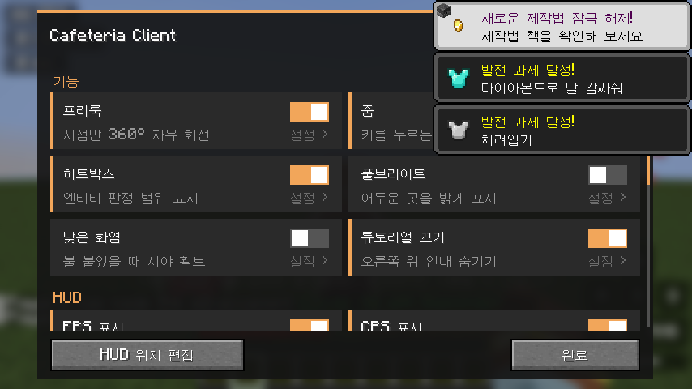
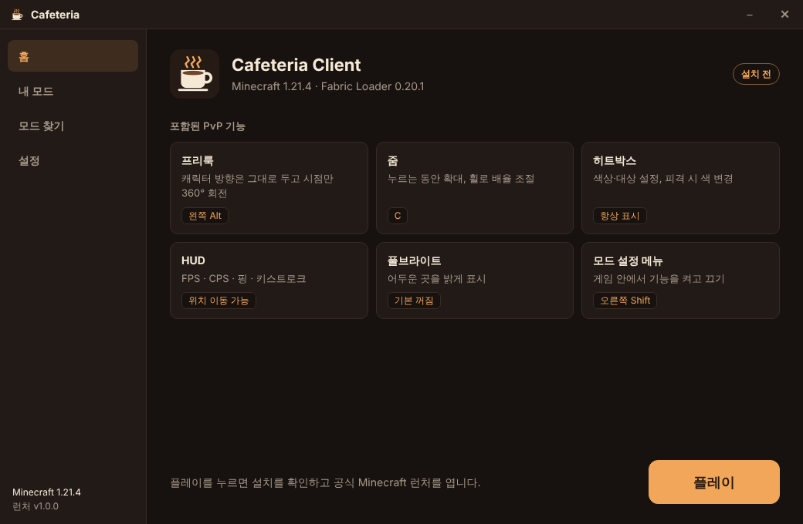
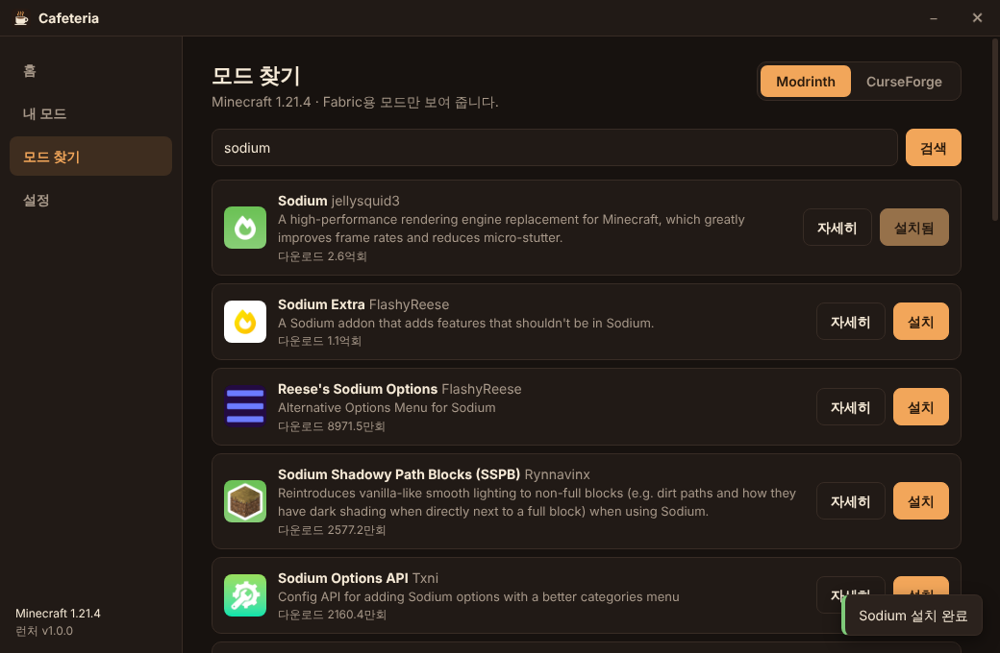
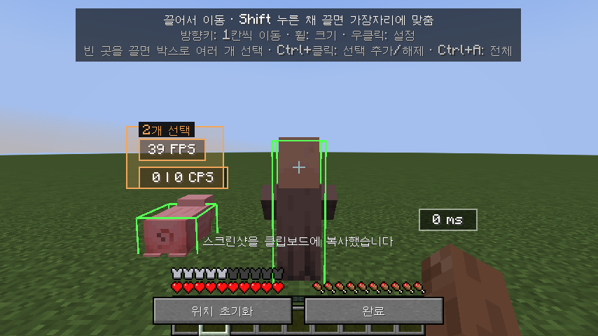
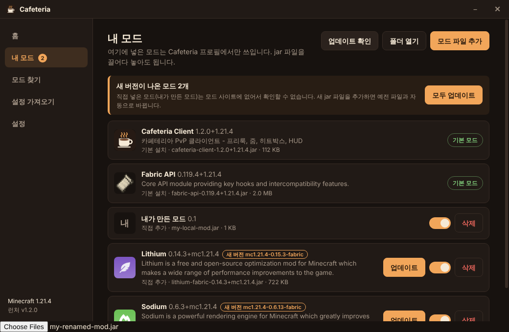
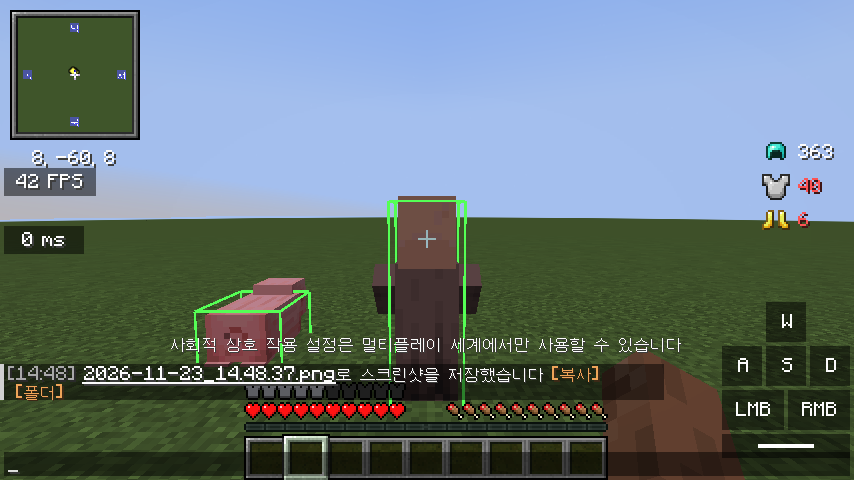

# Cafeteria (카페테리아)

Minecraft **1.21.4 (Fabric)** 용 PvP 클라이언트와 런처입니다.
PvP에 필요한 기능만 기본으로 넣고, 나머지는 런처에서 원하는 모드를 직접 추가해서 쓰는 구성입니다.

| 폴더 | 내용 |
| --- | --- |
| `mod/` | **Cafeteria Client** – 프리룩, 줌, 히트박스, HUD 가 들어 있는 Fabric 모드 |
| `launcher/` | **Cafeteria 런처** – 설치, 모드 관리, Modrinth/CurseForge 모드 다운로드 (Electron) |
| `branding/`, `tools/` | 아이콘과 아이콘 생성 스크립트 |
| `docs/screenshots/` | 테스트에서 찍은 실제 화면 |
| `CLAUDE.md`, `docs/HANDOFF.md` | 개발을 이어받을 때 읽는 문서 (코드 규칙·명령어, 현재 상태와 남은 일) |

| 게임 안 모드 설정 메뉴 | 런처 |
| --- | --- |
|  |  |
|  |  |
|  |  |
|  | |

## 기능

### 클라이언트 (게임 안)

| 기능 | 기본 키 | 설명 |
| --- | --- | --- |
| 프리룩 | 왼쪽 Alt | 캐릭터가 보는 방향은 그대로 두고 카메라만 360° 회전. "누르는 동안" / "토글" 선택 |
| 줌 | C | 누르는 동안 확대(기본 4배). 휠로 배율 조절, 확대한 만큼 감도 자동 보정, 부드러운 전환, 시네마틱 카메라. 줌하는 동안에는 손(든 아이템)이 화면 아래로 내려가 시야를 가리지 않음("줌 중 손 숨기기", 끄면 손이 평소 크기로 그대로 보임) |
| 히트박스 | 항상 표시 | 선 색상, 표시 대상(전체/생물/플레이어), 피격 시 색 변경, 눈높이 선, 시선 방향 선, 내 히트박스 |
| 풀브라이트 (감마) | G | 어두운 곳을 밝게 표시. 키로 바로 켜고 끄며 밝기는 1~15 로 조절 (기본 꺼짐) |
| 낮은 화염 | – | 불이 붙었을 때 시야를 가리는 불꽃을 아래로 내림 (기본 꺼짐) |
| 튜토리얼 끄기 | – | 오른쪽 위에 뜨는 "나무를 캐세요" 같은 바닐라 튜토리얼 안내를 자동으로 끔 |
| 깨끗한 메뉴 배경 | – | ESC 메뉴나 모드 설정을 열 때 뒤 화면을 흐리게 하는 효과를 끄고, 얼마나 어둡게 덮을지(0~80%)를 직접 정함. 흐림 효과가 검게 나오는 환경에서도 게임 화면이 그대로 보임 |
| 채팅 시간 | – | 채팅 메시지 왼쪽에 받은 시각 표시. 형식(24시간 / 초 포함 / 오전·오후), 색, 대괄호 설정 |
| 무한 채팅 | – | 채팅 기록 100줄 제한을 풀어서 한참 전 채팅까지 올려 볼 수 있음 |
| 스크린샷 도구 | F2 (바닐라) | 스크린샷 저장 안내 옆에 **[복사]** **[폴더]** 버튼. [복사]를 누르면 그림이 클립보드에 들어가 메신저에 바로 붙여 넣을 수 있음. "찍으면 자동 복사" 옵션 |
| HUD | – | FPS · CPS(좌/우) · 핑 · 키스트로크 · 갑옷 상태 · 포션 효과(효과 아이콘 + 이름 + 남은 시간, 10초 이하면 빨간색) · 좌표 · 콤보 · 리치. 채팅보다 앞에 그려져서 채팅에 가려지지 않음 |
| 모드 설정 메뉴 | 오른쪽 Shift | 기능 켜기/끄기, 세부 설정, HUD 위치 편집 |

**HUD 위치 편집** (설정 메뉴 → "HUD 위치 편집")

| 조작 | 동작 |
| --- | --- |
| 끌기 | 이동 (여러 개를 선택했으면 간격을 유지한 채 함께 이동) |
| 빈 곳을 끌기 | 박스를 그려서 닿은 요소를 한꺼번에 선택 |
| Ctrl + 클릭 / Ctrl + A | 선택에 추가·해제 / 전체 선택 |
| Shift 누른 채 끌기 | 화면 가장자리·가운데, 다른 요소의 가장자리·가운데에 맞춰 붙음 (안내선 표시) |
| 방향키 | 선택한 요소를 1픽셀씩 이동 (Shift 와 함께 누르면 10픽셀) |
| 휠 | 크기 조절 (선택한 묶음 위에서 굴리면 묶음 전체) |
| 오른쪽 클릭 | 그 요소의 설정 열기 |

- 키는 마인크래프트 **설정 → 조작 → Cafeteria Client** 에서 바꿀 수 있습니다.
- Cafeteria 키는 다른 모드와 같은 키를 써도 동작합니다. (예: Xaero 월드맵의 "빠른 확인"도 오른쪽 Shift 를 씁니다.)
- Xaero 미니맵이 설치돼 있으면 HUD 기본 위치가 미니맵 아래로 잡힙니다.
- 설정은 게임 폴더의 `config/cafeteria.json` 에 저장됩니다.

### 런처

- **로그인** – Microsoft 계정으로 로그인합니다. 한 번 로그인하면 런처를 다시 켜도 유지되고, 홈의 계정 줄에서 로그아웃할 수 있습니다.
- **플레이** – 기본은 **바로 실행**입니다. Cafeteria 모드와 Fabric API 를 설치하고, 게임 파일(Minecraft 1.21.4, 라이브러리, 에셋, Java 21)이 없으면 받은 뒤, 공식 Minecraft 런처 없이 게임을 바로 켭니다. 설정에서 "공식 런처로 실행"으로 바꾸면 예전처럼 공식 Minecraft 런처에 `Cafeteria` 프로필을 등록하고 공식 런처를 엽니다.
- **내 모드** – jar 파일 추가(파일 선택 또는 끌어다 놓기), 켜기/끄기, 삭제. 전용 게임 폴더(`.cafeteria`)를 쓰므로 기존 `.minecraft` 의 모드와 섞이지 않습니다.
  직접 넣은 모드도 이름·버전·아이콘이 표시됩니다. jar 안에 아이콘이 없으면 파일 해시로 Modrinth 에서 찾아 채웁니다.
- **모드 찾기** – 런처 안에서 1.21.4 Fabric 용 모드를 검색해서 바로 설치합니다. 꼭 필요한 다른 모드(필수 의존성)도 함께 받습니다.
  - **Modrinth**: 바로 사용 가능
  - **CurseForge**: 본인 API 키를 설정에 입력해야 사용 가능 ([발급 안내](https://support.curseforge.com/support/solutions/articles/9000208346-about-the-curseforge-api-and-how-to-apply-for-a-key))
- **설정 가져오기** – 루나 클라이언트나 기본 마인크래프트에서 쓰던 설정을 찾아서 Cafeteria 게임 폴더로 복사합니다 (아래 "다른 클라이언트에서 넘어오기" 참고).
- **모드 업데이트** – 런처를 켤 때(또는 "업데이트 확인"을 누르면) 받은 모드의 새 버전을 찾아 "내 모드"에 표시합니다. 모드별 "업데이트" 또는 "모두 업데이트"로 바꿉니다 (아래 "모드 업데이트" 참고).
- **자동 업데이트** – 런처를 켤 때 새 버전을 확인해서 내려받고, 다시 시작하면 설치합니다. Cafeteria 모드는 런처에 들어 있어서 함께 업데이트됩니다.
- **설정** – 게임 실행 방식(바로 실행 / 공식 런처로 실행), 메모리(RAM), 게임 창 크기, Java 실행 파일, 추가 JVM 인수, 플레이 후 런처 닫기, 게임 폴더, 공식 런처 위치, CurseForge API 키, 자동 업데이트, 모드 업데이트 확인, 설치 복구, 로그 폴더 열기, 프로필 제거, 설정 초기화
  - **게임 실행 방식**: "바로 실행"은 런처에서 로그인하고 게임을 직접 켭니다 (Windows 64비트 전용, 기본값). "공식 런처로 실행"은 공식 Minecraft 런처에 프로필을 등록하고 공식 런처를 엽니다. Windows 64비트가 아닌 환경에서는 항상 공식 런처로 실행합니다.
  - "공식 Minecraft 런처 위치"와 "프로필 제거"는 공식 런처로 실행할 때만 쓰입니다.

## 사용 방법

1. `Cafeteria-Setup-1.3.0.exe` 를 실행해서 설치합니다. 바탕화면과 시작 메뉴에 `Cafeteria` 바로가기가 생깁니다.
   (설치 없이 쓰고 싶으면 `Cafeteria-1.3.0-win-x64.zip` 의 압축을 풀고 `Cafeteria.exe` 를 실행해도 됩니다.)
2. 런처를 열고 **Microsoft 계정으로 로그인**합니다. (정품 Minecraft: Java Edition 계정 필요. 로그인하지 않고 플레이를 누르면 로그인 창이 먼저 뜹니다.)
3. **플레이**를 누르면 게임 파일을 확인하고(없으면 받고) 마인크래프트가 바로 켜집니다. 공식 Minecraft 런처는 없어도 됩니다.
   - 처음 한 번은 약 630MB 를 받습니다. 공식 런처로 1.21.4 를 해 본 PC 는 그 파일(게임 본체, 라이브러리, 에셋)을 복사해서 쓰고, Java 약 100MB 만 받습니다.
   - 받은 게임 파일은 `%APPDATA%\.cafeteria` 에 두고, 다음부터는 다시 받지 않습니다.
4. 게임 안에서 **오른쪽 Shift** 로 모드 설정 메뉴를 엽니다.

> 삭제는 Windows 설정의 "앱" 목록에서 Cafeteria 를 제거하면 됩니다. 게임 폴더(`%APPDATA%\.cafeteria`)의 모드와 설정은 남습니다.
>
> 서명되지 않은 프로그램이라 처음 실행할 때 Windows 가 "Windows의 PC 보호" 경고를 띄울 수 있습니다. "추가 정보 → 실행"을 누르면 됩니다.

## 모드 업데이트

| 모드 종류 | 업데이트 방법 |
| --- | --- |
| Cafeteria Client, Fabric API (기본 모드) | 런처가 관리합니다. 런처가 업데이트되면 다음 플레이 때 함께 바뀝니다. |
| 런처로 받은 모드, 직접 넣었지만 Modrinth 에 올라와 있는 모드 | "내 모드 → 업데이트 확인". 파일 해시로 지금 버전을 알아내고 1.21.4 Fabric 용 새 버전을 찾습니다. |
| CurseForge 에서 받은 모드 | 같은 방법. 설정에 CurseForge API 키가 있어야 확인됩니다. |
| 사이트에 없는 모드 (직접 만든 모드 등) | 새 jar 를 "모드 파일 추가"나 끌어다 놓기로 넣으면, 같은 모드(모드 id 가 같은 것)의 예전 파일이 자동으로 지워집니다. |

- 정식(release) 버전을 쓰는 중이면 정식 버전으로만 올리고, 베타·알파를 쓰는 중이면 더 새로운 베타·알파도 받습니다.
- 새 파일을 다 받고 해시 검증까지 끝난 뒤에 예전 파일을 지우므로, 중간에 실패해도 예전 모드는 그대로 남습니다.
- 꺼 둔 모드는 업데이트해도 꺼진 채로 둡니다. 새 버전이 추가로 요구하는 필수 모드가 있으면 함께 설치합니다.
- 자동으로 바꾸지는 않습니다. 확인만 자동으로 하고, 바꾸는 것은 버튼을 누를 때만 합니다. (서버나 다른 모드와의 호환 때문에 예전 버전을 일부러 쓰는 경우가 있어서입니다.)

## 다른 클라이언트에서 넘어오기

런처의 **설정 가져오기**가 아래 위치를 훑어서 가져올 수 있는 항목을 보여 줍니다. 원본은 건드리지 않고 복사만 합니다.

- 기본 마인크래프트 폴더: `%APPDATA%\.minecraft`
- 루나 클라이언트 폴더: `%USERPROFILE%\.lunarclient` 아래에서 게임 폴더처럼 보이는 곳
- 그 밖의 위치는 "폴더 직접 선택"으로 지정 (`options.txt` 나 `config` 폴더가 들어 있는 폴더)

| 항목 | 파일 |
| --- | --- |
| 게임 설정 (키 설정, 감도, 비디오) | `options.txt` |
| 서버 목록 | `servers.dat` |
| Xaero 미니맵·월드맵 설정 | `config/xaero/`, `config/xaerohud.txt` 등 (`config` 폴더의 `xaero…` 파일) |
| Xaero 웨이포인트·지도 데이터 | `xaero/minimap/`, `xaero/world-map/` (예전 버전: `XaeroWaypoints/`, `XaeroWorldMap/`) |
| 다른 모드 설정 | `config/` 의 나머지 |
| 리소스팩, 셰이더팩, 싱글플레이 월드 | `resourcepacks/`, `shaderpacks/`, `saves/` |

- Xaero 파일 위치는 Xaero's Minimap 26.5.0 과 World Map 1.46.0 (1.21.4 Fabric) 을 실제로 실행해서 확인한 것입니다.
- 루나가 어느 폴더를 게임 폴더로 쓰는지는 설치마다 다를 수 있습니다. 못 찾으면 루나 런처의 프로필 설정(톱니바퀴) → Mods 탭의 폴더 아이콘으로 실제 위치를 확인하세요.
- **루나 자체 기능의 설정**(루나의 줌·프리룩·HUD 위치 등)은 형식이 달라 옮길 수 없습니다. 게임 안 설정 메뉴에서 다시 맞춰야 합니다.

## 알아 둘 점

- **로그인은 Microsoft 의 공식 승인을 받은 방식이 아닙니다.** 마인크래프트 공식 런처의 공개 클라이언트 ID 로 로그인합니다 (다른 서드파티 런처들도 같은 방식을 씁니다). Microsoft 가 이 방식을 막으면 로그인이 안 될 수 있고, 그때는 설정의 "게임 실행 방식"을 "공식 런처로 실행"으로 바꿔 쓰세요.
- **계정 정보 저장**: 로그인을 유지하기 위한 refresh 토큰만 OS 보안 저장소(Windows 에서는 DPAPI)로 암호화해서 이 PC 의 런처 설정 폴더(`%APPDATA%` 아래 Electron userData, `account.json`)에 둡니다. 게임용 접근 토큰은 메모리에만 있고, 비밀번호는 런처가 받지 않습니다. 로그아웃하면 `account.json` 이 삭제됩니다. 암호화를 쓸 수 없는 환경에서는 디스크에 저장하지 않아서, 런처를 끄면 로그아웃됩니다.
- **공식 런처로 실행**을 고른 경우, 공식 런처가 켜져 있는 상태에서 플레이를 누르면 새 프로필이 바로 보이지 않을 수 있습니다. 공식 런처를 완전히 끈 뒤 다시 플레이를 눌러 주세요.
- **서버 규칙을 확인하세요.** 프리룩처럼 일부 서버에서 금지하는 기능이 있을 수 있습니다. 서버마다 허용 범위가 다르니 접속하는 서버의 규칙을 따르고, 금지된 기능은 설정 메뉴에서 꺼 두세요.
- **히트박스**는 바닐라의 `F3 + B` 와 같은 정보를 보여 줍니다. 바닐라와 똑같이 투명 상태인 엔티티는 표시하지 않고, 서버가 "디버그 정보 축소"를 켜 둔 경우에도 표시되지 않습니다.
- **줌 키(C)** 는 바닐라의 "핫바 저장"(크리에이티브 전용)과 겹쳐서 조작 설정에 빨갛게 표시되지만 줌은 정상 동작합니다. 거슬리면 둘 중 하나의 키를 바꾸면 됩니다.
- **콤보·리치 표시**는 내 클라이언트가 이미 알고 있는 정보(내가 때린 상대가 맞는 동작을 했는지, 조준선이 닿은 거리)로 계산한 참고값입니다.
- **자동 업데이트**는 설치 파일로 설치한 경우에만 스스로 설치합니다. 압축본으로 쓰는 경우에는 새 버전이 나왔다는 알림만 뜹니다.
- **깨끗한 메뉴 배경**은 기본으로 켜져 있습니다. 바닐라처럼 흐린 배경을 원하면 설정 메뉴에서 끄거나 "배경 흐림"을 켜면 됩니다.
- **채팅 시간·무한 채팅**은 켠 뒤에 올라온 메시지부터 적용됩니다. 무한 채팅은 메모리를 끝없이 쓰지 않도록 10만 줄까지만 보관합니다.
- **스크린샷 복사**는 Windows 와 Linux 에서 동작합니다 (macOS 미지원). 게임을 끄면 클립보드의 그림이 사라질 수 있으니 붙여 넣은 뒤에 끄세요.
- **직접 넣은 모드의 아이콘·새 버전**을 찾을 때 파일 해시(SHA-1)를 Modrinth 에 보냅니다. 파일 자체나 개인 정보는 보내지 않습니다.
- **CurseForge** 는 API 키가 있어야 하고, 제작자가 외부 프로그램 다운로드를 막아 둔 모드는 런처에서 받을 수 없습니다. 그런 모드는 CurseForge 사이트에서 받아 "모드 파일 추가"로 넣으세요. API 키는 약관상 다른 사람과 공유할 수 없어서 런처에 내장하지 않았습니다.

## 개발

### 모드 (`mod/`)

Java 21 이 필요합니다. Gradle 은 래퍼(`gradlew`)가 알아서 받습니다.

```bash
cd mod
./gradlew build
```

결과물: `mod/build/libs/cafeteria-client-1.3.0+1.21.4.jar`

실제 게임을 띄워서 모듈 동작을 확인하는 자동 테스트가 있습니다. 화면이 없는 환경(서버, CI)에서는 `xvfb-run` 으로 감쌉니다.

```bash
./gradlew runClientGameTest
```

```bash
./gradlew runProductionClientGameTest
```

- `runClientGameTest` – 개발 환경에서 실행
- `runProductionClientGameTest` – 배포용 jar 를 정식 마인크래프트 + Fabric Loader 에 올려서 실행 (유저가 쓰는 구성과 동일)
- 스크린샷은 `mod/build/run/*/screenshots/` 에 저장됩니다.
- 다른 모드와 함께 돌려 호환성을 보려면 `-PextraMods=/경로/a.jar,/경로/b.jar` 를 붙입니다 (`runProductionClientGameTest` 에서만).
- 스크린샷 복사 검사는 `xclip` 이 있으면 게임 밖 프로그램에서도 클립보드 그림을 꺼내 봅니다 (없으면 그 부분만 건너뜀).
- 서버 리소스팩을 다루는 모드(FastPack 등)의 호환성은 `mod/tools/pack_server.py` 로 테스트용 리소스팩 서버를 띄우고
  `-PtestJvmArgs="-Dcafeteria.test.packUrl=… -Dcafeteria.test.packSha1=…"` 를 붙여 `ServerResourcePackTest` 로 확인합니다.

### 런처 (`launcher/`)

Node.js 22 이상이 필요합니다. 런처에 넣을 모드 jar 가 있어야 하므로 모드를 먼저 빌드하세요.

```bash
cd launcher
npm install
```

```bash
npm start
```

```bash
npm test
```

```bash
npm run build:win
```

- `npm test` – 단위 테스트. Modrinth 와 Fabric 서버에 실제로 접속하는 검사가 들어 있습니다 (`CAFETERIA_OFFLINE=1` 이면 그 검사는 건너뜀).
- `node test/e2e/run.js` – 런처를 실제로 띄워 설치 → 플레이 → 모드 설치/삭제 → 설정까지 확인합니다 (Playwright 필요, 진짜 `.minecraft` 는 건드리지 않음). `CAFETERIA_E2E_EXECUTABLE` 에 빌드된 실행 파일 경로를 주면 패키징된 런처를 대상으로 검사합니다.
- `npm run build:win` – `launcher/dist/` 에 설치 파일 `Cafeteria-Setup-1.3.0.exe`, 압축본 `Cafeteria-1.3.0-win-x64.zip`, 자동 업데이트용 `latest.yml` 과 `.blockmap` 을 만듭니다. Linux 에서 빌드를 확인했습니다 (Windows·macOS 에서는 확인하지 못했습니다).
  - Windows 가 아닌 곳에서 설치 파일을 만들려면 원래 Wine 이 필요하지만, `scripts/build-win.js` 가 electron-builder 에 들어 있는 "실행하지 않고 언인스톨러를 꺼내는" 구현을 쓰도록 해서 Wine 없이 빌드합니다. 이 때문에 electron-builder 버전은 고정해 두었습니다.
  - 빌드가 끝나면 설치 파일과 언인스톨러에 대해 NSIS 무결성 검사(CRC)를 미리 해 보고, 실패하면 빌드를 중단합니다.

### 새 버전 내기 (자동 업데이트)

런처는 GitHub 저장소 [`lhj080902/cafeteria`](https://github.com/lhj080902/cafeteria) 의 최신 릴리스에서 새 버전을 찾습니다. 로그인 없이 받을 수 있어야 하므로 **저장소가 공개(public)여야 합니다.**

1. `mod/gradle.properties` 의 `mod_version` 과 `launcher/package.json` 의 `version` 을 올립니다. (마인크래프트·Fabric 버전을 바꿀 때는 `launcher/src/main/constants.js` 도 함께)
2. 모드를 빌드하고(`./gradlew build`) 런처를 빌드합니다(`npm run build:win`).
3. GitHub 에서 `v버전` 태그(예: `v1.2.0`)로 릴리스를 만들고 `launcher/dist/` 의 세 파일을 올립니다:
   `Cafeteria-Setup-버전.exe`, `Cafeteria-Setup-버전.exe.blockmap`, `latest.yml`
4. 릴리스를 게시하면, 이전 버전 런처가 다음에 켜질 때 새 버전을 내려받습니다.

저장소 주소를 바꾸려면 `launcher/package.json` 의 `build.publish` 와 `launcher/src/main/constants.js` 의 `RELEASES_URL` 을 고칩니다.

## 검증 현황

| 대상 | 방법 | 결과 |
| --- | --- | --- |
| 모드 (개발 환경) | 실제 클라이언트 실행 자동 테스트: 프리룩, 줌, 히트박스, CPS·콤보·리치, 갑옷·포션 HUD, 키 겹침, 설정 화면(한국어/영어), HUD 편집(끌기·맞춤·방향키·휠·박스 선택·묶음 이동), 풀브라이트 단축키, 낮은 화염, 튜토리얼 끄기, 포션 효과 아이콘(바닐라 아이콘 숨김 포함), 줌 중 손 숨김·복귀와 손 크기 불변(픽셀 비교), 메뉴 배경 밝기·선명도, 채팅 시간, 무한 채팅, HUD 가 채팅보다 앞인지, 스크린샷 복사(클립보드를 게임 밖 프로그램으로 확인), 설정 저장 | 통과 |
| 모드 (배포용 jar) | 같은 테스트를 정식 Minecraft 1.21.4 + Fabric Loader 0.20.1 + Fabric API 0.119.4 에서 실행 | 통과 |
| 모드 + 다른 모드 | 같은 테스트를 Xaero's Minimap 26.5.0, World Map 1.46.0, FastPack 0.3.1 과 함께 실행 | 통과 |
| 스크린샷 복사 (Windows) | Linux(X11)에서만 확인. Windows 의 클립보드 동작과 PowerShell 예비 경로는 실행해 보지 못함 | **실제 Windows 미검증** |
| 런처 로직 | 단위 테스트 162개 (159 통과, 3 건너뜀. 설치, 프로필 등록, 모드 관리, 다운로드 검증, 설정 가져오기, 업데이트 상태 처리, 모드 업데이트 확인·교체, 로그인 절차와 계정 저장, 게임 파일 검증·복사, 실행 인수 조립, Modrinth·Mojang·Fabric 실제 서버). Windows 에서도 실행해 통과 | 통과 |
| 런처 (Windows) | Windows 에서 소스 실행(Electron 45.4.1, 임시 폴더 대상)으로 짧은 자동 부팅 검사: 콘솔 오류 없이 켜지고, 홈 화면(계정 줄, 상태 칩, 플레이 안내)과 설정 화면(게임 실행 방식)이 그려지며, 실행 방식을 바꾸면 홈 화면이 따라 바뀜. 전체 수동 검사는 아님 | 통과 (부팅·화면만) |
| Microsoft 로그인 창 | 단위 테스트(가짜 서버)만. 실제 Microsoft·Xbox·Minecraft 서버로 로그인해 보지 못함 | **실제 서비스 미검증** |
| 게임 바로 실행 | 단위 테스트(가짜 서버, 가짜 프로세스)와 고정 해시의 실제 서버 검사만. 런처에서 게임 파일을 받고 게임을 켜 보지 못함 | **실제 실행 미검증** |
| 모드 빌드 (Windows) | `./gradlew compileGametestJava` 가 JDK 21 에서 성공함. 게임 테스트(`runClientGameTest`)는 이 PC 에서 돌리지 않음 | 컴파일만 확인 |
| 모드 업데이트 | Modrinth 실제 서버로 확인: 예전 버전의 Sodium·Lithium 을 넣어 두고 새 버전을 찾아 바꿔 넣기 (단위 테스트와 화면 테스트 둘 다). CurseForge 쪽은 가짜 응답으로만 검사 | 통과 (CurseForge 는 **실제 서버 미검증**) |
| 런처 화면 | Linux 에서 런처를 띄워 전체 흐름 자동 테스트 (소스 실행, 패키징된 실행 파일 둘 다) | 통과 |
| 자동 업데이트 | 상태 처리 로직은 가짜 업데이터로 검사, 빌드된 `latest.yml` 의 해시·크기가 설치 파일과 일치하는지 확인 | **실제 업데이트 수신 미검증** (1.2.2 설치본이 게시된 1.3.0 릴리스를 받는지는 릴리스 뒤에야 확인할 수 있음) |
| 루나 설정 찾기 | 가짜 폴더 구조로만 검사. 실제 루나 설치의 폴더 구조는 확인하지 못함 | **실제 PC 미검증** |
| CurseForge 연동 | API 키가 없어 공식 문서의 응답 형식대로 만든 가짜 응답으로만 검사 | **실제 서버 미검증** |
| 설치 파일 | 1.2.2 까지 Linux 에서 설치 파일을 풀어서 검사: 설치될 파일이 빌드 결과와 동일, 언인스톨러 포함, NSIS 무결성 검사(CRC) 통과, 아이콘 적용. 1.3.0 의 `npm run build:win` 은 Windows 에서 돌려 보지 못함 | 1.2.2 통과, **1.3.0 Windows 빌드 미검증** |
| Windows 실행 | 실행 파일 구조·아이콘·버전 정보 검사까지만 수행. 설치 과정과 프로그램 실행은 해 보지 못함 | **실제 Windows 미실행** |

런처 화면 자동 테스트(E2E)는 Linux 에서만 확인된 테스트이고 1.3.0 에서는 다시 돌리지 못했습니다. Windows 에서의 실제 동작(Microsoft 로그인, 게임 파일 받기와 게임 실행, 설치 과정, 자동 업데이트)은 직접 실행해 보아야 합니다. **1.3.0 은 아직 릴리스하지 않았습니다.** 위 항목을 실제로 돌려 본 뒤에 릴리스합니다.

## 참고 자료

- [Fabric 개발 문서](https://fabricmc.net/develop/) · [Fabric 설치기 소스](https://github.com/FabricMC/fabric-installer) (프로필 등록 방식)
- [Modrinth API 문서](https://docs.modrinth.com/api/)
- [CurseForge REST API 문서](https://docs.curseforge.com/rest-api/) · [API 키 안내](https://support.curseforge.com/support/solutions/articles/9000208346-about-the-curseforge-api-and-how-to-apply-for-a-key) · [서드파티 API 약관](https://support.curseforge.com/support/solutions/articles/9000207405-curse-forge-3rd-party-api-terms-and-conditions)
- [launcher_profiles.json 형식 (Minecraft Wiki)](https://minecraft.wiki/w/Launcher_profiles.json)
- [Microsoft 인증과 Azure 앱 승인 (Minecraft Wiki)](https://minecraft.wiki/w/Minecraft_Wiki:Projects/wiki.vg_merge/Microsoft_Authentication_Scheme)
