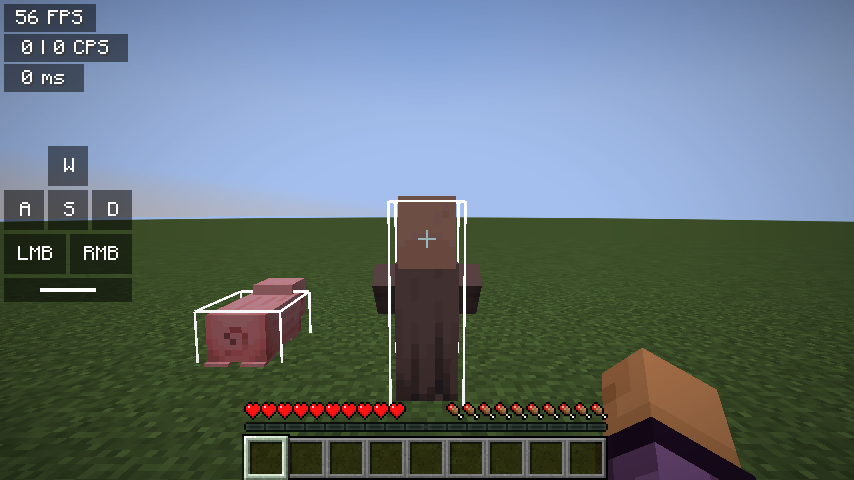

# Cafeteria (카페테리아)

Minecraft **1.21.4 (Fabric)** 용 PvP 클라이언트와 런처입니다.
PvP에 필요한 기능만 기본으로 넣고, 나머지는 런처에서 원하는 모드를 직접 추가해서 쓰는 구성입니다.

| 폴더 | 내용 |
| --- | --- |
| `mod/` | **Cafeteria Client** – 프리룩, 줌, 히트박스, HUD 가 들어 있는 Fabric 모드 |
| `launcher/` | **Cafeteria 런처** – 설치, 모드 관리, Modrinth/CurseForge 모드 다운로드 (Electron) |
| `branding/`, `tools/` | 아이콘과 아이콘 생성 스크립트 |
| `docs/screenshots/` | 테스트에서 찍은 실제 화면 |

| 게임 안 모드 설정 메뉴 | 런처 |
| --- | --- |
|  |  |
|  |  |

## 기능

### 클라이언트 (게임 안)

| 기능 | 기본 키 | 설명 |
| --- | --- | --- |
| 프리룩 | 왼쪽 Alt | 캐릭터가 보는 방향은 그대로 두고 카메라만 360° 회전. "누르는 동안" / "토글" 선택 |
| 줌 | C | 누르는 동안 확대(기본 4배). 휠로 배율 조절, 확대한 만큼 감도 자동 보정, 부드러운 전환, 시네마틱 카메라 |
| 히트박스 | 항상 표시 | 선 색상, 표시 대상(전체/생물/플레이어), 피격 시 색 변경, 눈높이 선, 시선 방향 선, 내 히트박스 |
| 풀브라이트 | 기본 꺼짐 | 어두운 곳을 밝게 표시 (밝기 조절) |
| HUD | – | FPS · CPS(좌/우) · 핑 · 키스트로크. 크기·배경·글자색 설정, 마우스로 끌어서 위치 이동 |
| 모드 설정 메뉴 | 오른쪽 Shift | 기능 켜기/끄기, 세부 설정, HUD 위치 편집 |

- 키는 마인크래프트 **설정 → 조작 → Cafeteria Client** 에서 바꿀 수 있습니다.
- 설정은 게임 폴더의 `config/cafeteria.json` 에 저장됩니다.

### 런처

- **플레이** – Fabric 로더 정보, Cafeteria 모드, Fabric API 를 자동으로 설치하고 공식 Minecraft 런처에 `Cafeteria` 프로필을 등록한 뒤 공식 런처를 엽니다.
- **내 모드** – jar 파일 추가(파일 선택 또는 끌어다 놓기), 켜기/끄기, 삭제. 전용 게임 폴더(`.cafeteria`)를 쓰므로 기존 `.minecraft` 의 모드와 섞이지 않습니다.
- **모드 찾기** – 런처 안에서 1.21.4 Fabric 용 모드를 검색해서 바로 설치합니다. 꼭 필요한 다른 모드(필수 의존성)도 함께 받습니다.
  - **Modrinth**: 바로 사용 가능
  - **CurseForge**: 본인 API 키를 설정에 입력해야 사용 가능 ([발급 안내](https://support.curseforge.com/support/solutions/articles/9000208346-about-the-curseforge-api-and-how-to-apply-for-a-key))
- **설정** – 메모리(RAM), 게임 창 크기, Java 실행 파일, 추가 JVM 인수, 플레이 후 런처 닫기, 게임 폴더, 공식 런처 위치, CurseForge API 키, 설치 복구, 로그 폴더 열기, 프로필 제거, 설정 초기화

## 사용 방법

1. **공식 Minecraft 런처**를 설치하고 한 번 실행해서 로그인해 둡니다. (정품 Java Edition 계정 필요)
2. `Cafeteria-1.0.0-win-x64.zip` 의 압축을 풀고 `Cafeteria.exe` 를 실행합니다.
3. **플레이**를 누르면 설치가 끝난 뒤 공식 런처가 열립니다. `Cafeteria` 프로필이 선택된 상태에서 플레이를 누르세요.
4. 게임 안에서 **오른쪽 Shift** 로 모드 설정 메뉴를 엽니다.

> 서명되지 않은 프로그램이라 처음 실행할 때 Windows 가 "Windows의 PC 보호" 경고를 띄울 수 있습니다. "추가 정보 → 실행"을 누르면 됩니다.

## 알아 둘 점

- **로그인과 게임 실행은 공식 런처가 맡습니다.** 새로 만든 런처가 Microsoft 계정 로그인을 직접 처리하려면 Azure 앱 ID 를 등록하고 Mojang 의 승인을 받아야 해서, 승인 절차 없이 바로 쓸 수 있는 공식 런처 연동 방식을 택했습니다.
- **공식 런처가 켜져 있는 상태에서 플레이를 누르면** 새 프로필이 바로 보이지 않을 수 있습니다. 공식 런처를 완전히 끈 뒤 다시 플레이를 눌러 주세요.
- **서버 규칙을 확인하세요.** 프리룩처럼 일부 서버에서 금지하는 기능이 있을 수 있습니다. 서버마다 허용 범위가 다르니 접속하는 서버의 규칙을 따르고, 금지된 기능은 설정 메뉴에서 꺼 두세요.
- **히트박스**는 바닐라의 `F3 + B` 와 같은 정보를 보여 줍니다. 바닐라와 똑같이 투명 상태인 엔티티는 표시하지 않고, 서버가 "디버그 정보 축소"를 켜 둔 경우에도 표시되지 않습니다.
- **줌 키(C)** 는 바닐라의 "핫바 불러오기"(크리에이티브 전용)와 겹쳐서 조작 설정에 빨갛게 표시되지만 줌은 정상 동작합니다. 거슬리면 둘 중 하나의 키를 바꾸면 됩니다.
- **CurseForge** 는 API 키가 있어야 하고, 제작자가 외부 프로그램 다운로드를 막아 둔 모드는 런처에서 받을 수 없습니다. 그런 모드는 CurseForge 사이트에서 받아 "모드 파일 추가"로 넣으세요. API 키는 약관상 다른 사람과 공유할 수 없어서 런처에 내장하지 않았습니다.

## 개발

### 모드 (`mod/`)

Java 21 이 필요합니다. Gradle 은 래퍼(`gradlew`)가 알아서 받습니다.

```bash
cd mod
./gradlew build
```

결과물: `mod/build/libs/cafeteria-client-1.0.0+1.21.4.jar`

실제 게임을 띄워서 모듈 동작을 확인하는 자동 테스트가 있습니다. 화면이 없는 환경(서버, CI)에서는 `xvfb-run` 으로 감쌉니다.

```bash
./gradlew runClientGameTest
```

```bash
./gradlew runProductionClientGameTest
```

- `runClientGameTest` – 개발 환경에서 실행
- `runProductionClientGameTest` – 배포용 jar 를 정식 마인크래프트 + Fabric Loader 에 올려서 실행 (유저가 쓰는 구성과 동일)
- 스크린샷은 `mod/build/run/*/screenshots/` 에 저장됩니다.

### 런처 (`launcher/`)

Node.js 22 이상이 필요합니다. 런처에 넣을 모드 jar 가 있어야 하므로 모드를 먼저 빌드하세요.

```bash
cd launcher
npm install
```

```bash
npm start
```

```bash
npm test
```

```bash
npm run build:win
```

- `npm test` – 단위 테스트. Modrinth 와 Fabric 서버에 실제로 접속하는 검사가 들어 있습니다 (`CAFETERIA_OFFLINE=1` 이면 그 검사는 건너뜀).
- `node test/e2e/run.js` – 런처를 실제로 띄워 설치 → 플레이 → 모드 설치/삭제 → 설정까지 확인합니다 (Playwright 필요, 진짜 `.minecraft` 는 건드리지 않음).
- `npm run build:win` – `launcher/dist/Cafeteria-1.0.0-win-x64.zip` 생성. Windows, macOS, Linux 어디서든 빌드됩니다.
- `npm run build:win:installer` – 설치 프로그램(NSIS) 생성. Windows 에서 실행하거나, Linux/macOS 라면 Wine 이 필요합니다.

버전을 올릴 때는 `mod/gradle.properties` 와 `launcher/src/main/constants.js` 의 버전을 함께 맞춰 주세요.

## 검증 현황

| 대상 | 방법 | 결과 |
| --- | --- | --- |
| 모드 (개발 환경) | 실제 클라이언트 실행 자동 테스트: 프리룩, 줌, 히트박스, CPS, 설정 화면(한국어/영어), HUD 이동, 풀브라이트, 설정 저장 | 통과 |
| 모드 (배포용 jar) | 같은 테스트를 정식 Minecraft 1.21.4 + Fabric Loader 0.20.1 + Fabric API 0.119.4 에서 실행 | 통과 |
| 런처 로직 | 단위 테스트 73개 (설치, 프로필 등록, 모드 관리, 다운로드 검증, Modrinth 실제 서버) | 통과 |
| 런처 화면 | Linux 에서 런처를 띄워 전체 흐름 자동 테스트 | 통과 |
| CurseForge 연동 | API 키가 없어 공식 문서의 응답 형식대로 만든 가짜 응답으로만 검사 | **실제 서버 미검증** |
| Windows 실행 | 실행 파일 구조·아이콘·버전 정보 검사까지만 수행 | **실제 Windows 미실행** |

Windows 에서의 실제 동작(공식 런처 자동 실행 포함)은 Linux 환경에서 확인할 수 없어 직접 실행해 보아야 합니다.

## 참고 자료

- [Fabric 개발 문서](https://fabricmc.net/develop/) · [Fabric 설치기 소스](https://github.com/FabricMC/fabric-installer) (프로필 등록 방식)
- [Modrinth API 문서](https://docs.modrinth.com/api/)
- [CurseForge REST API 문서](https://docs.curseforge.com/rest-api/) · [API 키 안내](https://support.curseforge.com/support/solutions/articles/9000208346-about-the-curseforge-api-and-how-to-apply-for-a-key) · [서드파티 API 약관](https://support.curseforge.com/support/solutions/articles/9000207405-curse-forge-3rd-party-api-terms-and-conditions)
- [launcher_profiles.json 형식 (Minecraft Wiki)](https://minecraft.wiki/w/Launcher_profiles.json)
- [Microsoft 인증과 Azure 앱 승인 (Minecraft Wiki)](https://minecraft.wiki/w/Minecraft_Wiki:Projects/wiki.vg_merge/Microsoft_Authentication_Scheme)
